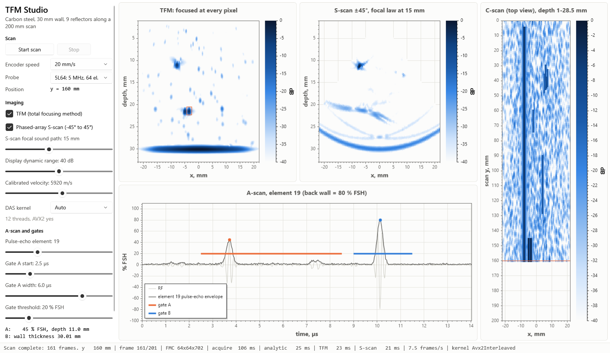
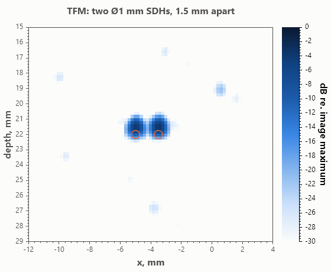
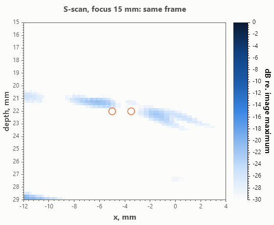
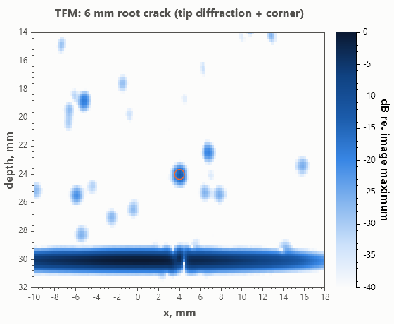
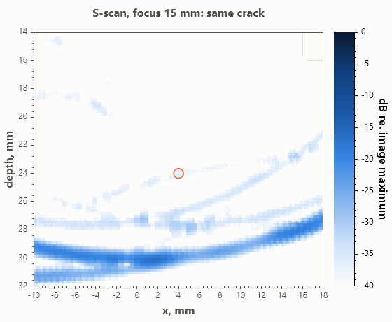
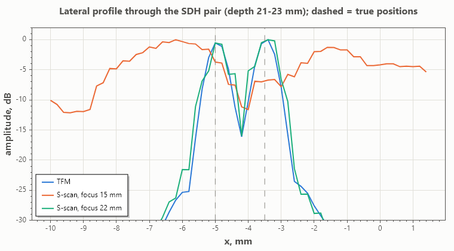
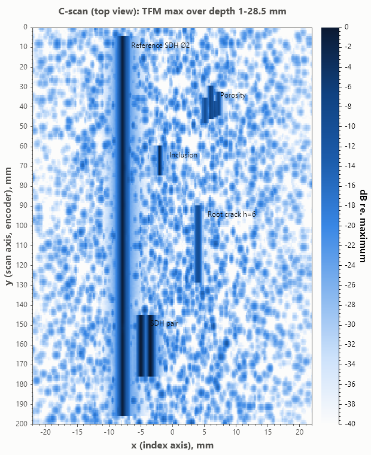
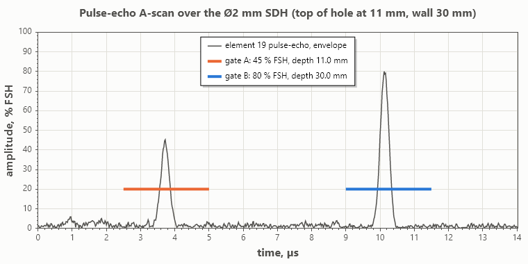
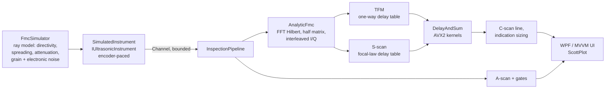

# TFM Studio: phased-array ultrasonic and TFM imaging workstation (C# / .NET 10 / WPF)

[](https://github.com/Linklow/tfm-studio/actions/workflows/ci.yml)


A desktop application and library for **phased-array ultrasonic testing (PAUT)** and the **Total
Focusing Method (TFM)**. A simulated FMC-capable instrument scans a 30 mm steel test plate with a
5 MHz, 64-element probe. Each encoder step yields a full matrix capture (64 × 64 A-scans). The
software reconstructs a TFM image and a conventional phased-array S-scan from the same data,
builds a C-scan, and gives the operator a flaw-detector A-scan with gates. Everything runs live:
about 8 frames/s in the UI and 10 frames/s headless on a 6-core laptop.



*Frame at y = 160 mm. Two Ø1 mm side-drilled holes 1.5 mm apart: TFM (left) resolves them. The
S-scan, with its focal law at 15 mm, smears them into one streak at 22 mm depth. The C-scan (right)
is built line by line during the scan. Bottom: pulse-echo A-scan with gate A on the hole and gate
B on the back wall (wall thickness 30.01 mm).*

## What this project demonstrates

| Area | In this repository |
|---|---|
| Ultrasonic NDT domain | Focal laws (steering and focusing), sectorial scan, FMC/TFM, gates and %FSH, wall thickness, -6 dB sizing, crack-tip diffraction sizing, C-scan, array performance indicator |
| Signal processing | Radix-2 FFT, Hilbert transform and analytic signal, delay-and-sum beamforming with sub-sample interpolation |
| Performance engineering | AVX2/FMA kernels, data-layout redesign (interleaved I/Q), half-matrix reciprocity, cached delay tables, `Parallel.For`, BenchmarkDotNet |
| Instrument software architecture | `IUltrasonicInstrument` hardware abstraction, encoder-paced async acquisition, producer/consumer pipeline on `System.Threading.Channels`, settings applied live mid-scan |
| Desktop UI | WPF + MVVM (CommunityToolkit.Mvvm source generators), ScottPlot.WPF, rendering kept out of the view model |
| Quality | 22 xUnit tests (physics checks, kernel equivalence, pipeline, I/O), GitHub Actions on Windows and Linux, warnings as errors, nullable on |

## Results: TFM vs phased-array S-scan

Both images are reconstructed from the same simulated FMC with the same delay-and-sum kernel, so
the only difference is the delay law. Reproduce with `dotnet run --project src/TfmStudio.Cli -c Release -- figures`.

| Metric | TFM | S-scan, focal law at 15 mm | S-scan, focal law at 22 mm |
|---|---:|---:|---:|
| Two Ø1 mm SDHs 1.5 mm apart at 22 mm: dip between them on the lateral profile (resolved if below -6 dB) | **-15.4 dB** | -4.1 dB (not resolved) | -15.5 dB |
| -6 dB lateral width of one of these SDHs | **0.8 mm** | 4.6 mm | 1.2 mm |
| Array performance indicator (-6 dB area / λ², lower is sharper) | **0.40** | 3.25 | 0.46 |
| 6 mm root crack: height from the tip-diffracted echo | **6.0 mm** | 6.0 mm | 6.2 mm |
| Crack-tip signal-to-noise ratio against grain noise | **34.8 dB** | 14.8 dB | 32.3 dB |

Full output: [`docs/figures/results.md`](docs/figures/results.md). The simulation is seeded, so the numbers reproduce exactly.

| TFM | S-scan, focal law at 15 mm |
|---|---|
|  |  |
|  |  |



What the comparison shows:

* **TFM is focused at every pixel.** A focused S-scan is just as sharp *at its focal depth*: with
  the focal law moved to 22 mm it also resolves the pair. Seven millimetres away from the focus,
  the same S-scan merges the two holes into one 4.6 mm wide indication. With TFM, the operator
  does not have to pick a focal depth.
* **Crack-tip diffraction.** The tip of a 6 mm back-wall-breaking crack is a weak diffracted echo.
  TFM images it well above the grain noise and sizes the crack height to within the 0.2 mm pixel.
  The defocused S-scan sees the tip at a much lower SNR, next to the curved back-wall arcs typical
  of sectorial scans.
* **Back wall.** TFM shows the back wall flat, with the shadow of the crack. The S-scan shows it as
  arcs, the familiar time-of-flight artefact of sectorial scans.

| C-scan of the whole 200 mm scan | Flaw-detector A-scan with gates |
|---|---|
|  |  |

## Performance

Delay-and-sum over one 5L64 frame (64 × 64 × 702 samples at 50 MHz) and a 221 × 161 = 35.6k-pixel
image, AMD Ryzen 5 5600H (6 cores / 12 threads, Zen 3), .NET 10:

| Kernel | Signals | Time per frame | vs. single-thread scalar |
|---|---|---:|---:|
| Scalar reference, 1 thread | full matrix, 4096 | 712 ms | 1× |
| Scalar, `Parallel.For` over rows | full matrix, 4096 | 119 ms | 6.0× |
| AVX2 gather + FMA, parallel | full matrix, 4096 | 105 ms | 6.8× |
| AVX2 index math + interleaved I/Q loads, parallel | full matrix, 4096 | 50 ms | 14× |
| **Same, half matrix (reciprocity)** | **2080** | **26 ms** | **27×** |
| *Analytic signal (FFT Hilbert) for 2080 signals* | | *28 ms* | |

Means from BenchmarkDotNet (`bench/TfmStudio.Benchmarks`, short job). The single-thread reference
is the median from `TfmStudio.Cli bench`. Laptop timings vary by about ±20 % with temperature.

How the kernel got there:

1. **Reference:** readable scalar loops, used by the tests as the oracle.
2. **AVX2 gather:** 8 pixels per instruction, but 4 gathers per pixel per pair. On Zen 3, gathers
   are microcoded and barely beat the scalar parallel loop.
3. **Data-layout fix:** samples are stored as interleaved I/Q (`re, im, re, im…`) with zero padding,
   so one unaligned 128-bit load returns everything linear interpolation needs
   (re<sub>i</sub>, im<sub>i</sub>, re<sub>i+1</sub>, im<sub>i+1</sub>). There are no bounds checks: delays are clamped into the
   padding. Index math stays in AVX2, and two pixels share one 128-bit FMA accumulator held in a register.
4. **Reciprocity:** TFM delays are symmetric in transmitter and receiver, so the half matrix
   (h<sub>tx,rx</sub> + h<sub>rx,tx</sub>, tx ≤ rx) gives the same image with 2080 instead of 4096 signals.

All kernels are checked against the reference to within 2·10⁻⁴ of the image peak
([`ImagingTests`](tests/TfmStudio.Core.Tests/ImagingTests.cs)).

## How it works



| Project | Contents |
|---|---|
| `src/TfmStudio.Core` | Physics (material, probe, pulse, reflectors), FMC simulator, FFT/Hilbert, focal laws, delay tables, DAS kernels, TFM and S-scan imagers, gates and image metrics, instrument abstraction and pipeline, `.fmc` file format. No UI dependencies; runs on Windows and Linux. |
| `src/TfmStudio.App` | WPF application (MVVM). The view model owns acquisition and processing; `PlotPresenter` owns rendering. |
| `src/TfmStudio.Plotting` | Shared ScottPlot theme, the amplitude colour map, image-to-heatmap helpers. |
| `src/TfmStudio.Cli` | `check`, `bench`, `figures`, `scan` commands; renders every figure in this README. |
| `tests/TfmStudio.Core.Tests` | xUnit tests. |
| `bench/TfmStudio.Benchmarks` | BenchmarkDotNet suite for the kernels. |

### Physics model

* **Probe:** 1-D linear array in direct contact, Gaussian-modulated pulse built from centre frequency
  and -6 dB bandwidth, element directivity `sinc(π·w·sinθ/λ)·cosθ`.
* **Propagation:** ray model with 2-D cylindrical spreading per leg and frequency-scaled attenuation.
  Side-drilled holes echo from their surface; the back wall uses an image source. A back-wall-breaking
  crack gives a corner-trap echo and a weak tip-diffracted echo.
* **Noise:** randomly placed grain scatterers give coherent noise that averaging cannot remove, and
  electronic noise is added per A-scan. The noise-free matrix is exactly reciprocal.
* **Scan:** reflectors have extents along the scan axis; scatterers near the scan plane are
  weighted by the passive-axis beam width.
* **Not modelled (yet):** wedges and refraction, mode conversion and shear-wave TFM modes,
  multiple back-wall echoes, anisotropy.

The tests pin the model to geometry: pulse-echo times of holes and the back wall, TFM peak
positions within 0.15 mm, focal laws that align all wavefronts at the focus, linear steering laws,
and FFT/Hilbert against closed forms.

## Quick start

Requires the [.NET 10 SDK](https://dotnet.microsoft.com/download). The WPF app needs Windows; the
core library, CLI and tests also run on Linux.

```bash
git clone https://github.com/Linklow/tfm-studio.git
cd tfm-studio
dotnet run --project src/TfmStudio.App -c Release             # the workstation
dotnet test                                                   # 22 tests
dotnet run --project src/TfmStudio.Cli -c Release -- bench    # kernel timings
dotnet run --project src/TfmStudio.Cli -c Release -- figures  # README figures + results.md
dotnet run --project src/TfmStudio.Cli -c Release -- scan     # full encoded scan, C-scan
dotnet run --project bench/TfmStudio.Benchmarks -c Release -- --filter *
```

In the app, press **Start scan**. Try the live controls: move the S-scan focal depth and watch
the pair sharpen at 22 mm; detune the calibrated velocity and watch the indications shift and
blur; switch the DAS kernel and compare frame times in the status bar.

Library use:

```csharp
var specimen = Scenarios.TestPlate();
var fmc = new FmcSimulator(specimen).Acquire(LinearArray.Probe5L64, y: 0.16);
var tfm = new TfmImager(specimen.Material.LongitudinalVelocity).Reconstruct(fmc, Scenarios.DefaultGrid());
var hole = ImageMetrics.SizeAt(tfm, x: -0.005, z: 0.022, searchRadius: 0.0005);
Console.WriteLine($"{hole.Length * 1e3:F2} mm at -6 dB, reconstructed in {tfm.ComputeTime.TotalMilliseconds:F0} ms");
```

## Roadmap

- [ ] Wedge support: Snell/Fermat delay laws through a wedge, angle-beam S-scans for weld inspection.
- [ ] Multi-mode TFM (direct, half-skip, full-skip with shear-wave legs).
- [ ] GPU kernel (ComputeSharp / CUDA) and a native C++ kernel through P/Invoke, compared against AVX2.
- [ ] TCG/DAC calibration on reference holes; amplitude-based sizing.
- [ ] Import of public experimental FMC datasets; replay instrument (`IUltrasonicInstrument` over files).

## Author

**Ivan Mishchenko** holds a B.S. in Instrument Engineering (non-destructive testing) and an M.S. in
Computer Science, with 3 years of NDT research at the Russian Academy of Sciences, and now works as
a software engineer. See also [aelocate](https://github.com/Linklow/aelocate), a project on acoustic
emission source location, and [Google Scholar](https://scholar.google.com/citations?user=AiYf5nwAAAAJ&hl=en).

References: C. Holmes, B. W. Drinkwater, P. D. Wilcox, *Post-processing of the full matrix of
ultrasonic transmit–receive array data for non-destructive evaluation*, NDT&E International 38 (2005)
701–711 (TFM, array performance indicator). Olympus, *Introduction to Phased Array Ultrasonic
Technology Applications* (focal laws, S-scans).

## License

MIT
